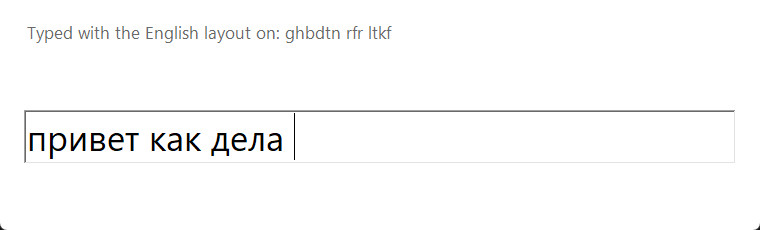
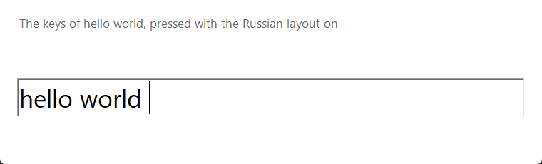

# Langflip

Langflip fixes a word typed in the wrong keyboard layout. Type `ghbd` with the English layout on, and it becomes «прив» as you type. The layout switches to Russian, and the rest of the word comes out right.

- **Languages** Russian (ЙЦУКЕН) and English (US QWERTY).
- **Words** any length. Words under 4 letters change on Space, only into a dictionary word: `z` turns into «я». Digits stay in the word, so `ьз3` turns into `mp3`.
- **Systems** Windows 10 and later, macOS 13 and later.
- **Privacy** no network and no typing log. The current word lives in memory until the next one starts. The decision log in `%LOCALAPPDATA%\Langflip\langflip.log` holds key counts and app names, not letters.

## Screenshots




`mise run demo` takes them again: it types into a demo window while Langflip runs, and takes the keyboard for about 5 seconds.

## Use it

- **Fix** happens while the word is typed, from the 4th letter, as soon as Langflip is sure. Otherwise on Space, Enter or Tab.
- **Undo** Pause on Windows, Ctrl+F12 on macOS. The word comes back as typed. After the second Undo of the same word it becomes an exception and stays as typed from then on.
- **Convert by hand** Shift+Pause on Windows, Ctrl+Shift+F12 on macOS.
- **Layout** the tray icon shows `EN` or `RU` in navy on a holo foil tile.
- **Pause** click the tray icon to turn fixing off. The icon turns grey. Click again to turn it on.
- **Switch the layout** double-click the tray icon to swap Russian and English.
- **Tray menu** a right click opens it: fixing on and off, start at login, the list of exceptions, the menu language, the settings file, quit. It speaks the system language until the Language submenu picks another: English, Russian, German, French, Spanish, Chinese, Japanese, Korean or Norwegian.
- **Autostart** the first start turns on start at login, with no question. On Windows a Task Scheduler task backs up the Run key. Uncheck Start at sign in in the tray menu to stop it.

The settings file is `%APPDATA%\Langflip\settings.toml` on Windows and `~/Library/Application Support/Langflip/settings.toml` on macOS. Its keys are in [docs/features.md](docs/features.md).

## Install it on Windows

Double-click `Langflip.cmd` in the repo folder. It builds Langflip, installs it and starts it.

- **Where** `%LOCALAPPDATA%\Programs\Langflip`, for the current user, with no admin rights.
- **Shortcuts** Langflip appears on the desktop and in the Start menu.
- **Remove it** Settings, Apps, Installed apps, Langflip, Uninstall. The settings file stays.
- **Needs** [mise](https://mise.jdx.dev) on `PATH`, then `mise install` once in the repo.

The release download is a bare `langflip.exe` with no installer yet. An installed Langflip updates itself from GitHub: a dialog offers each new release, with Update and Later.

## Run it from source

Install [mise](https://mise.jdx.dev), then:

```bash
mise install
mise x -- cargo run -p langflip
```

On macOS, allow Langflip (or the terminal running it) in System Settings, Privacy & Security, under Accessibility and Input Monitoring.

## Test it

| Command          | What it checks                                                                                                       |
| ---------------- | -------------------------------------------------------------------------------------------------------------------- |
| `mise run check` | format, clippy, unit tests, macOS compile, the same steps CI runs                                                    |
| `mise run eval`  | false fixes and misses of the model on `model/testset.tsv`                                                           |
| `mise run smoke` | Windows only: runs Langflip and types into a test window. Close Punto Switcher first, and don't type for 10 seconds. |

## Build and release

```bash
mise x -- cargo build --release -p langflip
```

The binary lands in `target/release/`. `mise run install`, the same as a double click on `Langflip.cmd`, builds it and installs it on this PC in `%LOCALAPPDATA%\Programs\Langflip`, in place of the running copy. Set `LANGFLIP_VERSION` to give it a version other than the one in `Cargo.toml`.

Each push to `main` that changes code makes a release. `.github/workflows/release.yml` builds `langflip.exe` on a GitHub Windows runner beside Checks. A failed Checks run cancels the build, and once Checks pass the release publishes `Langflip-<version>-windows-x64.exe` in the public [workbench-soft.github.io releases](https://github.com/workbench-soft/workbench-soft.github.io/releases), with a date version such as `v2026.10.30.1`. It needs the `RELEASES_TOKEN` secret. The exe is unsigned yet, and there is no macOS build.

## Rebuild the model

`mise run model` downloads the `wordfreq` word lists and writes `model/langflip.model` and `model/testset.tsv`. Run `mise run eval` after it.

## Docs

- [docs/features.md](docs/features.md) each feature and its limits.
- [docs/user-flows.md](docs/user-flows.md) the flows step by step.
- [docs/architecture.md](docs/architecture.md) modules, data and the path of a key press.
- [specs/layout-switcher.md](specs/layout-switcher.md) the plan and each change.

## License

The code is MIT. The model in `model/` comes from [wordfreq](https://github.com/rspeer/wordfreq) data and is under CC BY-SA 4.0, as that data is.
