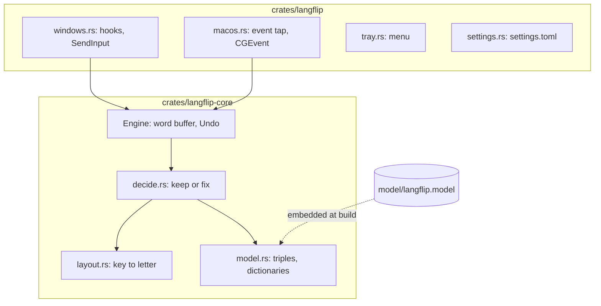
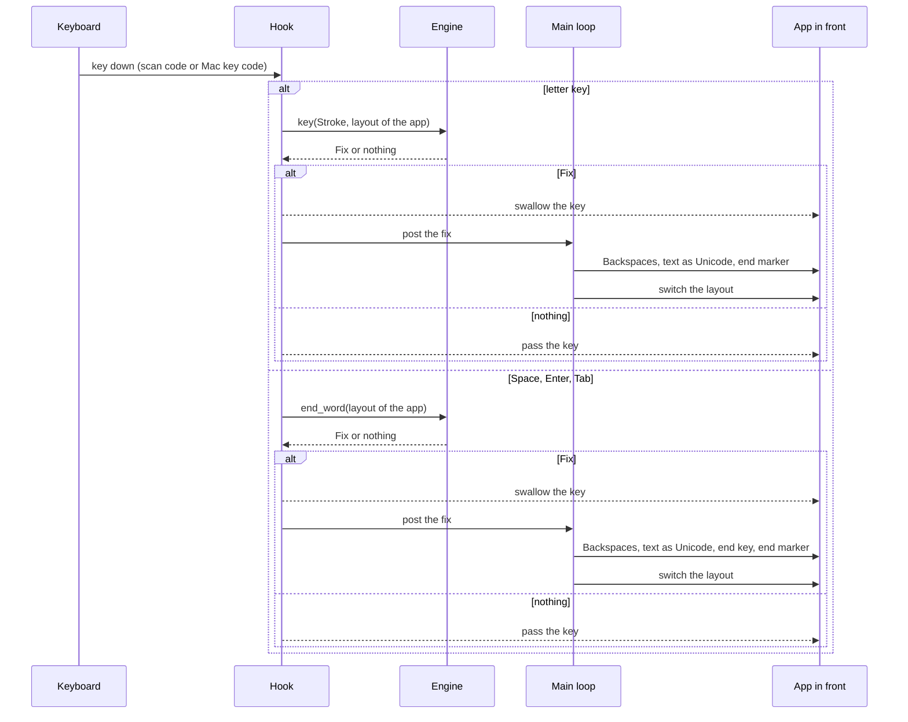

# Architecture

Langflip is a Cargo workspace with 2 crates and a model file. It has no server and makes no network calls.

## Modules

- **`langflip-core::layout`** key positions named after US keys, and the letters each layout puts on them. Static tables for US QWERTY and Russian ЙЦУКЕН.
- **`langflip-core::model`** reads `langflip.model`: per language an alphabet, a table of letter-triple log probabilities and a dictionary.
- **`langflip-core::decide`** compares the word as typed with the same keys in the other layout.
- **`langflip-core::Engine`** the word buffer, the last word for Undo and the manual fix, and `keep_words`.
- **`langflip::windows`** `WH_KEYBOARD_LL` and `WH_MOUSE_LL` hooks, `SetWinEventHook` for window and focus changes, `SendInput` for the fix, the Run key for autostart.
- **`langflip::macos`** a session `CGEventTap`, `CGEvent` posts for the fix, Text Input Sources for the layout.
- **`langflip::tray`** the tray icon and menu, shared by both systems.
- **`langflip::settings`** `settings.toml` in the user's app data folder.
- **`crates/langflip/build.rs`** writes the name, publisher, version and a manifest into `langflip.exe`. The release build passes its date version in `LANGFLIP_VERSION`.

## The path of a key press

1. The hook gets the key and maps its scan code (Windows) or key code (macOS) to a key position. Both follow the physical key, so the layout in use doesn't change the mapping.
2. A letter key goes into the buffer with its Shift and Caps Lock state. A digit without Shift goes in too, and types the same in both layouts. From the 4th letter the engine asks `decide_prefix`, and the hook swallows the key when a fix comes back. The fix types it in the other layout. One such fix per word.
3. Space, Enter or Tab ends the word. The engine asks `decide`, unless the word already switched, and the hook swallows the end key when a fix comes back.
4. The fix goes out as tagged events: Backspaces, the text as Unicode, the end key if there is one, an end marker. The hook lets tagged events through.
5. Keys the person presses before the end marker comes back wait in the hook and replay after it. On Windows they wait up to 100 ms more for the window to take the new layout. A Windows fix whose end marker hasn't come back after 1 s, such as one typed while the tray menu was open, lets them go.

## The decision

1. The typed word in `keep_words` or the dictionary of its layout: keep.
2. Fewer than 4 letters (digits don't count): fix only when the swapped word is in its dictionary, with no score. `z` turns into «я», `ьз3` into `mp3`.
3. Score the typed word and the swapped word: mean log probability per letter from the letter triples, with start and end marks.
4. Fix when the swapped word is in its dictionary and scores higher, or scores higher by `THRESHOLD` (1.0).
5. A trailing key that is punctuation in the current layout (`hello,`) is also tried apart from the word.

While the word is typed, `decide_prefix` judges the keys so far:

1. Fewer than 4 letters, a last key that is punctuation in the current layout, or typed letters that start a word of the dictionary or of `keep_words`: wait.
2. The swapped letters start no dictionary word of the other layout: wait.
3. Score both without the end mark. Switch when the swapped letters score higher by `PREFIX_GAIN` (1.0).

## The model file

`scripts/build_model.py` builds `model/langflip.model` from the `wordfreq` lists: the top 200,000 words per language train the triples, the top 100,000 of 4 letters or more form the dictionary. Words of 2 and 3 letters join it from a Zipf frequency of 4.5, words with digits such as `mp3` from 3.0, and the one letter words come from a list in the script (`a`, `i`; «а», «в», «и», «к», «о», «с», «у», «я»).

| Part | Format |
| --- | --- |
| magic | `LFM1` |
| per language, English then Russian | 2-byte tag `en` or `ru` |
| | u32 length and the alphabet in UTF-8 |
| | (alphabet + 1)³ little-endian f32 log probabilities, index 0 marks the word edge |
| | u32 length and the dictionary, one word per line |

`model/testset.tsv` holds 10,000 dictionary words and 10,000 rarer words per language for `mise run eval`.

## Outside services

None at run time. `mise run model` downloads the `wordfreq` package from PyPI.
