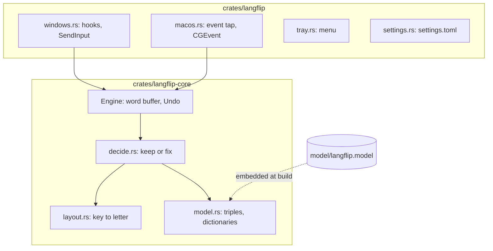
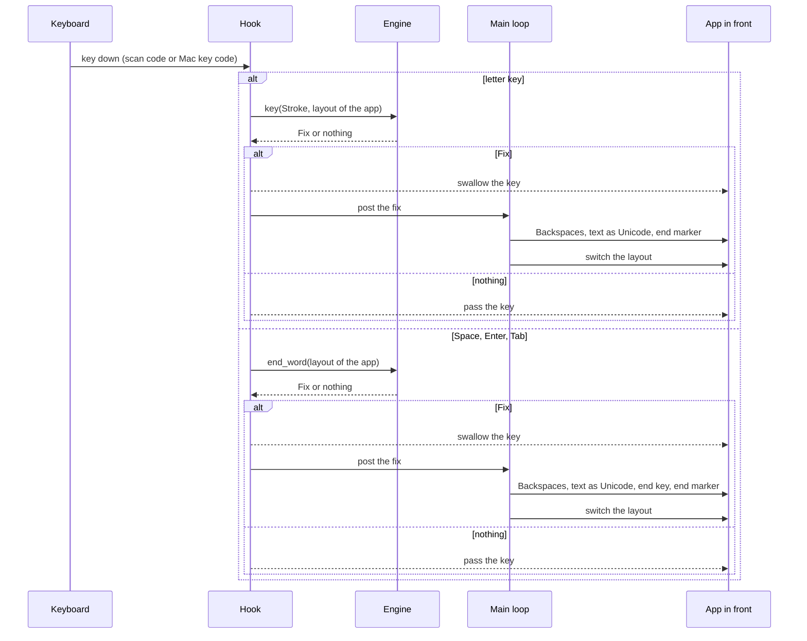

# Architecture

Langflip is a Cargo workspace with 2 crates and a model file. It has no server and makes no network calls.

## Modules

- **`langflip-core::layout`** key positions named after US keys, and the letters each layout puts on them. Static tables for US QWERTY and Russian ЙЦУКЕН.
- **`langflip-core::model`** reads `langflip.model`: per language an alphabet, a table of letter-triple log probabilities and a dictionary.
- **`langflip-core::decide`** compares the word as typed with the same keys in the other layout.
- **`langflip-core::Engine`** the word buffer, the last word for Undo and the manual fix, and `keep_words`.
- **`langflip::windows`** `WH_KEYBOARD_LL` and `WH_MOUSE_LL` hooks, `SetWinEventHook` for window and focus changes, `SendInput` for the fix, the Run key for autostart.
- **`langflip::macos`** a session `CGEventTap`, `CGEvent` posts for the fix, Text Input Sources for the layout.
- **`langflip::tray`** the tray icon and menu, shared by both systems.
- **`langflip::settings`** `settings.toml` in the user's app data folder.
- **`crates/langflip/build.rs`** writes the name, publisher, version and a manifest into `langflip.exe`. The release build passes its date version in `LANGFLIP_VERSION`.

## The path of a key press

1. The hook gets the key and maps its scan code (Windows) or key code (macOS) to a key position. Both follow the physical key, so the layout in use doesn't change the mapping.
2. A letter key goes into the buffer with its Shift and Caps Lock state. A digit without Shift goes in too, and types the same in both layouts. From the 4th letter the engine asks `decide_prefix`, and the hook swallows the key when a fix comes back. The fix types it in the other layout. One such fix per word.
3. Space, Enter or Tab ends the word. The engine asks `decide`, unless the word already switched, and the hook swallows the end key when a fix comes back.
4. The fix goes out as tagged events: Backspaces, the text as Unicode, the end key if there is one, an end marker. The hook lets tagged events through.
5. Keys the person presses before the end marker comes back wait in the hook and replay after it. On Windows they wait up to 100 ms more for the window to take the new layout. A Windows fix whose end marker hasn't come back after 1 s, such as one typed while the tray menu was open, lets them go.

## The decision

1. The typed word in `keep_words` or the dictionary of its layout: keep.
2. Fewer than 4 letters (digits don't count): fix only when the swapped word is in its dictionary, with no score. `z` turns into «я», `ьз3` into `mp3`.
3. Score the typed word and the swapped word: mean log probability per letter from the letter triples, with start and end marks.
4. Fix when the swapped word is in its dictionary and scores higher, or scores higher by `THRESHOLD` (1.0).
5. A trailing key that is punctuation in the current layout (`hello,`) is also tried apart from the word.

While the word is typed, `decide_prefix` judges the keys so far:

1. Fewer than 4 letters, a last key that is punctuation in the current layout, or typed letters that start a word of the dictionary or of `keep_words`: wait.
2. The swapped letters start no dictionary word of the other layout: wait.
3. Score both without the end mark. Switch when the swapped letters score higher by `PREFIX_GAIN` (1.0).

## The model file

`scripts/build_model.py` builds `model/langflip.model` from the `wordfreq` lists: the top 200,000 words per language train the triples, the top 100,000 of 4 letters or more form the dictionary. Words of 2 and 3 letters join it from a Zipf frequency of 4.5, words with digits such as `mp3` from 3.0, and the one letter words come from a list in the script (`a`, `i`; «а», «в», «и», «к», «о», «с», «у», «я»).

| Part                               | Format                                                                           |
| ---------------------------------- | -------------------------------------------------------------------------------- |
| magic                              | `LFM1`                                                                           |
| per language, English then Russian | 2-byte tag `en` or `ru`                                                          |
|                                    | u32 length and the alphabet in UTF-8                                             |
|                                    | (alphabet + 1)³ little-endian f32 log probabilities, index 0 marks the word edge |
|                                    | u32 length and the dictionary, one word per line                                 |

`model/testset.tsv` holds 10,000 dictionary words and 10,000 rarer words per language for `mise run eval`.

## Outside services

None at run time. `mise run model` downloads the `wordfreq` package from PyPI.

## Decisions

The choices that shape Langflip, the most costly to undo first.

### Language and crate split: Rust, a core crate and an app crate

- **Picked** a Cargo workspace. `langflip-core` holds the layouts, the model and the decision with no OS code. `langflip` holds the hooks, the tray and the settings for each system.
- **Why** the org stack puts CLI tools and heavy work in Rust. The hook decides inside its callback, so the code has to answer in microseconds with no garbage collector pause. The core tests run on any OS, and CI checks the macOS build from Windows.
- **Trade-off** each system gets its own layer written against raw APIs: the `windows` crate on Windows, `objc2` and `core-graphics` on macOS. A fix in one layer has to be made again in the other.
- **Rejected**
  - **C#** the org rules forbid new C# code, and it would cover Windows only.
  - **One crate** the decision code would mix with OS calls, and its tests would need the OS they were written on.
- **Cost to undo** high. A switch rewrites both crates.

### Key capture: low level hooks inside the Langflip process

- **Picked** `WH_KEYBOARD_LL` and `WH_MOUSE_LL` on Windows, a session `CGEventTap` on macOS. Both run in Langflip's own process.
- **Why** a low level hook sees each key in every app without loading code into other processes. The hook can swallow a key, which a fix needs.
- **Trade-off** Langflip can't see keys in elevated windows unless it runs as admin. On macOS the person has to grant Accessibility and Input Monitoring access.
- **Rejected**
  - **A hook DLL in other processes** the spec rules it out. A DLL would load into each app, with a 32 bit and a 64 bit build to keep.
  - **An input method (TSF on Windows, an input source on macOS)** the person would have to pick Langflip as the layout, in place of the Russian and English layouts it reads. This reason is a guess, since no source records the rival.
- **Cost to undo** high. Each platform layer starts again.

### Decision model: letter triples and a dictionary from wordfreq

- **Picked** per language, a table of letter triple log probabilities and a dictionary. `scripts/build_model.py` builds both from the `wordfreq` word lists.
- **Why** a lookup in the triple table takes microseconds, so the hook answers inside its callback. `mise run eval` measured at most 0.08% false fixes and 1.6% (English) to 3.8% (Russian) misses at a threshold of 1.0.
- **Trade-off** a rare word whose first letters start a word of the other language can switch early. Undo puts it back.
- **Rejected**
  - **Dictionary only** a word outside the dictionary would stay wrong. The score catches it.
  - **A score for words under 4 letters** a string of 1 to 3 letters scores too noisily. Short words go by the dictionary only.
- **Cost to undo** medium. A new model touches `decide.rs`, `model.rs`, the build script and the model file format.

### The fix: tagged Unicode events

- **Picked** the fix sends Backspaces, then the word as Unicode text, then an end marker. Each event carries the Langflip tag, so the hook lets it through. Keys typed during a fix wait in the hook and replay after the marker.
- **Why** Unicode text comes out right whatever layout the window has at that moment. The tag keeps Langflip from judging its own keys.
- **Trade-off** keys typed during a fix replay before the layout switch lands, so they keep the old layout. A fix that gets stuck, such as one typed while the tray menu is open, needs a 1 s timeout to let the held keys go.
- **Rejected**
  - **Switch the layout, then replay the scan codes** a window takes up to 100 ms to take the new layout. Keys sent before that would come out in the old one.
- **Cost to undo** medium. Both platform layers send the fix.

### Layout mapping: static tables

- **Picked** static tables for US QWERTY and Russian ЙЦУКЕН. The hook turns a key into a position named after the US key, and the core looks up the letter in each table.
- **Why** Langflip supports 2 fixed layouts, and the tables give the same letters on Windows and macOS. The spec made this change from the first plan.
- **Trade-off** other layouts don't work. On the macOS `Russian` layout (not `Russian - PC`) the `ё` key sits elsewhere, so `ё` words may miss.
- **Rejected**
  - **`ToUnicodeEx` and `UCKeyTranslate`** the system calls would read any layout. Each system answers in its own way, and the core tests would need the OS.
- **Cost to undo** medium. The tables, the key mapping and the tests change.

### Distribution: a bare exe on GitHub Releases and a local install script

- **Picked** the release workflow publishes `langflip.exe` in the public `workbench-soft.github.io` repo. `mise run install` and `Langflip.cmd` build it and install it in `%LOCALAPPDATA%\Programs\Langflip`, with shortcuts and an entry in Settings, Apps.
- **Why** the org ships releases from the public site repo. An install in the user's folder needs no admin rights.
- **Trade-off** the exe is unsigned, so SmartScreen warns on the first run. No macOS build ships, since that needs a Mac runner.
- **Rejected**
  - **Run from `target`** the autostart path would point into the repo.
  - **Mac App Store** its sandbox blocks input to other apps.
- **Cost to undo** low. The release workflow and the install scripts change.

### Model storage: built into the exe

- **Picked** the build embeds `model/langflip.model` in the binary. Each language keeps a sorted word list to check whether typed letters start a word.
- **Why** one file to install, with no model to lose or mismatch. The sorted list loads in about 20 ms.
- **Trade-off** a new model needs a new build.
- **Rejected**
  - **A set of every word start** it took 0.4 s to build at each start, so the sorted list replaced it.
  - **A model file next to the exe** the install would have a second file to keep in step with the code.
- **Cost to undo** low. `model.rs` reads the bytes either way.

### Settings: a tray menu and a TOML file

- **Picked** `tray-icon` draws the tray icon and menu on both systems. The rest sits in `settings.toml` in the app data folder.
- **Why** the spec swapped a Tauri settings window for the tray menu and a file in the first version. One tray code serves Windows and macOS.
- **Trade-off** the app exclusion list has no screen. The person edits the file.
- **Rejected**
  - **A Tauri settings window** a web view and a second UI stack for a few switches.
  - **Native tray code per system** `Shell_NotifyIcon` and `NSStatusItem` would mean 2 menus to keep in step.
- **Cost to undo** low. Only `tray.rs` and `settings.rs` change.

### Layout switch on Windows: `WM_INPUTLANGCHANGEREQUEST`

- **Picked** Langflip posts `WM_INPUTLANGCHANGEREQUEST` to the window in focus. After a tray double click it waits until that window is back in front.
- **Why** Windows keeps one layout for all windows. A request to the window in front switches it for the rest.
- **Trade-off** the request has to wait for the window to come back in front, up to 0.5 s.
- **Rejected**
  - **`ITfInputProcessorProfileMgr::ActivateProfile` with `TF_IPPMF_FORSESSION`** it returned OK and changed no window.
- **Cost to undo** low. One function in `windows.rs`.

### Menu languages: rust-i18n

- **Picked** `rust-i18n` builds the strings of `locales/app.yml` into the binary, and `sys-locale` picks the language at start.
- **Why** the org rules name `rust-i18n` for Rust, and each app ships 9 languages.
- **Trade-off** the menu follows the system language, with no picker of its own.
- **Rejected**
  - **Fluent** a second translation tool for a job the org rules already give to `rust-i18n`.
- **Cost to undo** low. The strings file and `language.rs`.
