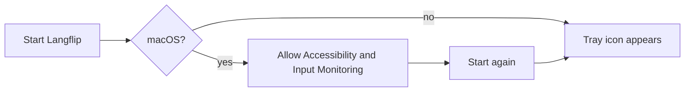
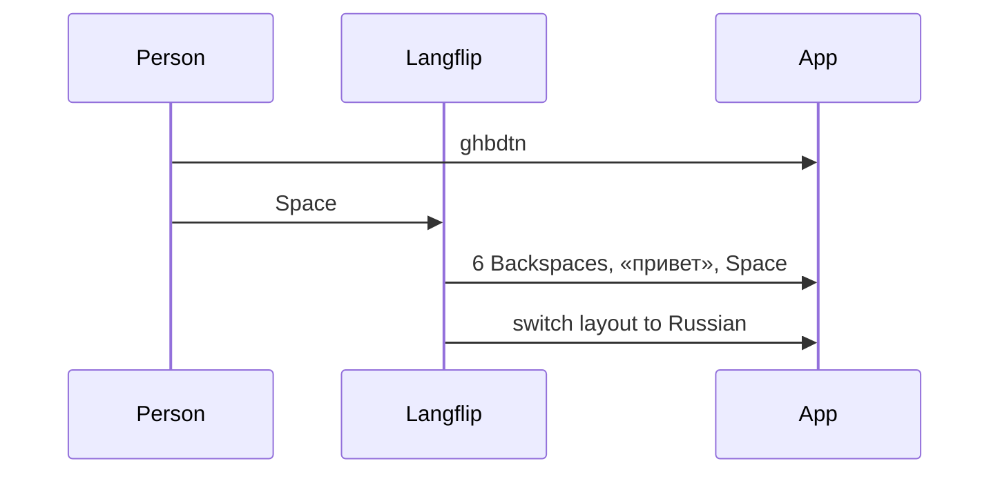
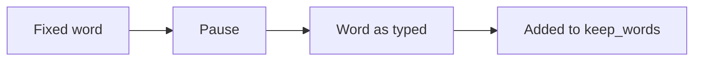
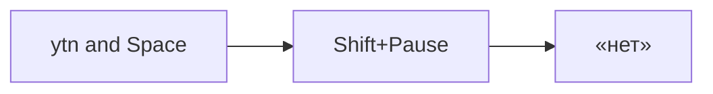
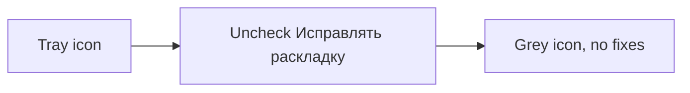

# User flows

## First start

1. The person runs `langflip.exe` (Windows) or `Langflip` (macOS).
2. On macOS the system asks for Accessibility and Input Monitoring access. The person allows both and starts Langflip again.
3. The tray shows a blue and red square. Langflip writes `settings.toml` with the defaults.

## A word in the wrong layout

1. The English layout is on. The person types `ghbdtn`.
2. The person presses Space.
3. Langflip erases `ghbdtn`, types «привет», types the Space and switches to Russian.
4. The person goes on typing in Russian.

## Undo

1. Langflip just fixed a word the person meant as typed, such as `vtnf` meant as a code name.
2. The person presses Pause (Ctrl+F12 on macOS).
3. Langflip puts the word back and switches the layout back.
4. Langflip keeps that word as typed from now on.

## Convert by hand

1. The person typed `ytn` (3 letters, so Langflip left it).
2. The person presses Shift+Pause (Ctrl+Shift+F12 on macOS).
3. Langflip converts it to «нет» and switches the layout.

## Turn it off

1. The person clicks the tray icon.
2. The person unchecks «Исправлять раскладку». The icon turns grey.
3. Typing passes through untouched until the person checks it again.

