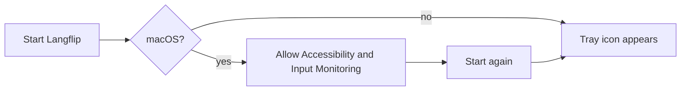
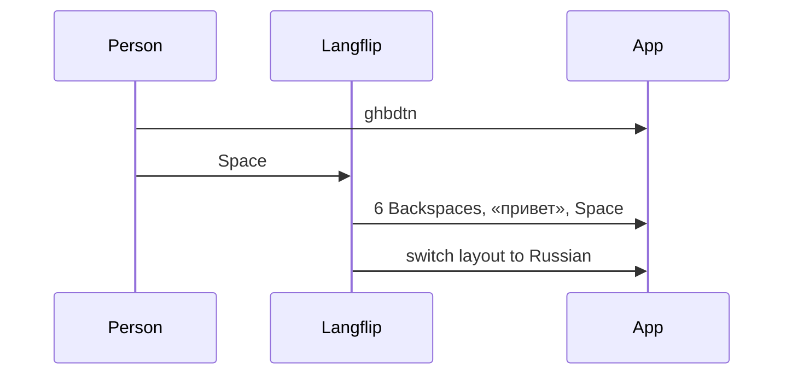
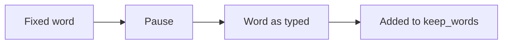
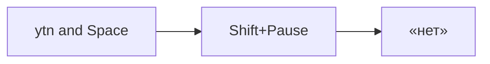
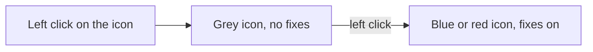
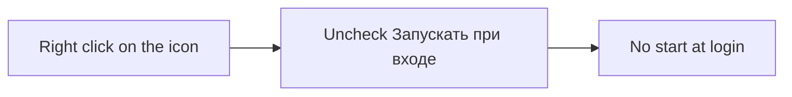

# User flows

## First start

1. The person runs `langflip.exe` (Windows) or `Langflip` (macOS).
2. On macOS the system asks for Accessibility and Input Monitoring access. The person allows both and starts Langflip again.
3. The tray icon shows the current layout: `EN` on blue or `RU` on red. Langflip writes `settings.toml` with the defaults and turns on start at login, with no question.

## A word in the wrong layout

1. The English layout is on. The person types `ghbdtn`.
2. The person presses Space.
3. Langflip erases `ghbdtn`, types «привет», types the Space and switches to Russian.
4. The person goes on typing in Russian.

## Undo

1. Langflip just fixed a word the person meant as typed, such as `vtnf` meant as a code name.
2. The person presses Pause (Ctrl+F12 on macOS).
3. Langflip puts the word back and switches the layout back.
4. Langflip keeps that word as typed from now on.

## Convert by hand

1. The person typed `ytn` (3 letters, so Langflip left it).
2. The person presses Shift+Pause (Ctrl+Shift+F12 on macOS).
3. Langflip converts it to «нет» and switches the layout.

## Pause it

1. The person clicks the tray icon with the left button.
2. The icon turns grey and keeps the layout letters. Typing passes through untouched.
3. The next click turns fixing on, and the icon is blue or red again.

## Stop the autostart

1. The person right-clicks the tray icon.
2. The person unchecks «Запускать при входе».
3. Langflip no longer starts at login, and later starts keep it off.

